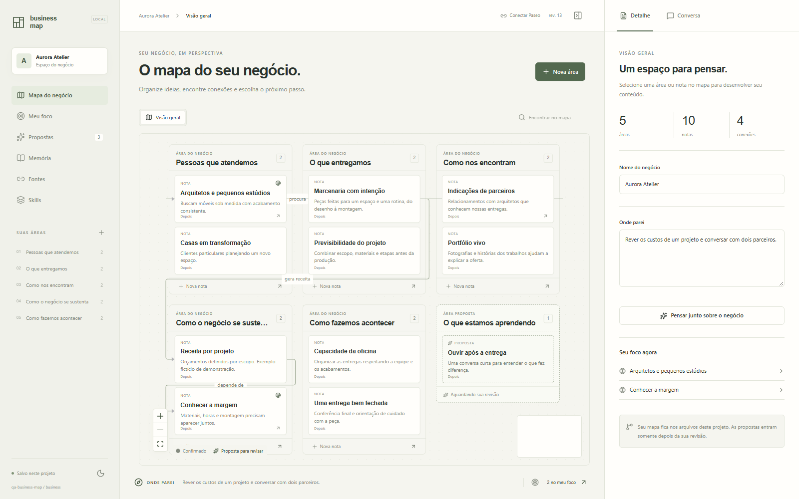

# Business Map

O piloto SaaS **Business Map Cloud** fica em [cloud/](cloud/README.md): mapa no site e propostas pelo ChatGPT via MCP. Ele é independente da instalação local descrita abaixo; não sincroniza seus dados automaticamente.

Um mapa local do negócio, construído por você e pelos agentes que já usa. Converse, conecte ideias, registre fontes e revise propostas antes de incorporá-las. Áreas e cards são livres; nenhuma metodologia é obrigatória. Funciona no navegador sem Paseo.



## Começar com seu agente

> Leia https://github.com/HumbertoCecim/business-map/blob/main/START-HERE.md e me ajude a criar ou continuar o mapa do meu negócio. Aproveite o que já conversamos e mostre um primeiro rascunho antes de fazer mais perguntas.

O [documento de entrada](START-HERE.md) e a [skill portátil](skills/business-map/SKILL.md) distinguem instalação local de acesso remoto. Com contexto, o agente começa pelo rascunho. Sem contexto, faz uma pergunta por vez, até quatro iniciais, com opção de gerar com o que há. É uma orientação ao agente: a aplicação não exige entrevista.

## Instalar

Requer Node.js **22.12 ou posterior**. Baixe o pacote e `SHA256SUMS.txt` na [release](https://github.com/HumbertoCecim/business-map/releases), confira o checksum e instale o arquivo baixado:

```sh
npm install --global ./business-map-0.5.0.tgz
business open --root /caminho/absoluto/do/negocio
```

Windows: `business open --root "C:\Negocios\MeuNegocio"`. A pasta deve existir e pode ser diferente da pasta do código. O comando abre o navegador com um código temporário de uso único e reutiliza o serviço ativo. `business stop --root <pasta>` encerra o serviço. Não há conta, sincronização ou SaaS nesta versão.

Para desenvolver:

```sh
git clone https://github.com/HumbertoCecim/business-map.git
cd business-map
npm ci
npm run build
node build/cli.mjs open --root /caminho/absoluto/do/negocio
```

## Usar

- Navegue pelas áreas, busque um card e ajuste o mapa à tela. O inspetor permite criar e editar; posições calculadas não alteram o conteúdo.
- Foco, importante/urgente, Agora/Depois e decisões são escolhas humanas.
- Pergunte ao Codex ou Claude no painel contextual. O Ask usa sua instalação e autenticação do provider; não continua automaticamente outro chat aberto no terminal.
- Sugestões têm tracejado e revisão individual. O agente acrescenta propostas, sem reescrever texto ou prioridades confirmados.
- Registre onde parou. Fechar a página não dispara outra chamada de IA.

O Ask é iniciado por você e envia contexto ao provider. O serviço valida a saída antes de registrar propostas. Instalação local não significa que o conteúdo enviado a um modelo fique no computador.

## MCP e CLI

O serviço expõe MCP por Streamable HTTP em loopback, com credencial de agente. Para clientes stdio, configure conforme o formato aceito pelo seu cliente:

```json
{"mcpServers":{"business-map":{"command":"business","args":["mcp","--root","/caminho/absoluto/do/negocio"]}}}
```

O adaptador stdio apenas encaminha chamadas: não abre outra store. Consulte `business --help` para os comandos `context`, `query`, `suggest` e `read-skill`. Os contratos MCP são:

| Ferramenta | Uso |
| --- | --- |
| `business_get_context` | Ler mapa e contexto atual. |
| `business_query` | Buscar, selecionar e encontrar caminhos. |
| `business_submit_suggestion` | Enviar propostas pendentes com revisão-base e identificador idempotente. |
| `business_read_skill` | Ler versões e recursos textuais importados, verificando hashes. |

A identidade externa é autodeclarada; autenticar a conexão não comprova o modelo. Permissões do ambiente podem restringir loopback ou processos; não há fallback para escrita direta. Veja [configuração e aprovações de Codex/Claude](docs/agents.md).

**ChatGPT web:** ler o GitHub não instala nem conecta localhost. É necessário um plugin MCP remoto ou túnel explícito, distribuição não incluída nesta entrega. [Documentação oficial](https://developers.openai.com/api/docs/guides/custom-mcp-server)

## Skills e fontes

Importe uma pasta com `SKILL.md` e revise texto e manifesto antes de confirmar. Referências, scripts e assets são preservados no projeto. A importação não executa scripts nem instala globalmente. Derivações preservam a origem; selecionar versões ativas é explícito. Um nome sem conteúdo continua não lido.

A pesquisa de [skills](docs/research-skills.md) e [livros](docs/research-books.md) oferece opções, sem instalação automática. Issues, URLs e trechos de logs entram como fontes selecionadas; não há coleta contínua nem escrita em serviços externos. Uma fonte técnica não comprova impacto comercial.

## Dados e arquitetura

O arquivo canônico é `<raiz>/.business-board/board.json`. Schema v3 preserva IDs e acrescenta relações e fontes. A primeira gravação migrada preserva backup imutável da versão anterior. Há revisão, fingerprint, recibos, backup e temporário + rename. Arquivo inválido não é substituído por quadro vazio.

O serviço é o único escritor. Navegador, CLI, MCP e adaptador Paseo usam sua API. Posse ambígua não é roubada por timeout. Runtime e credenciais ficam fora dos dados exportáveis.

Domínio e serviço não dependem de Paseo. React Flow e ELK produzem o mapa a partir dos dados. As proteções de autoria valem para operações do produto; ferramentas externas com acesso aos arquivos podem modificá-los diretamente.

Veja [Paseo e transição do 0.4](docs/paseo.md). Não mantenha o escritor antigo ativo durante migração. A documentação anterior foi preservada em [Paseo 0.4](docs/paseo-0.4.md).

## Desenvolver e contribuir

```sh
npm run typecheck
npm test
npm run build
npm pack
```

Exemplos públicos são fictícios. Não inclua dados reais de clientes, tokens, `.business-board`, runtime ou logs em commits/issues.

Licença MIT. A inspiração de navegação vem de [Floorplan](https://github.com/haydenschmitty/floorplan); seu scanner de código não é incluído. Dependências mantêm suas licenças, incluindo React Flow (MIT) e ELK (EPL-2.0).
