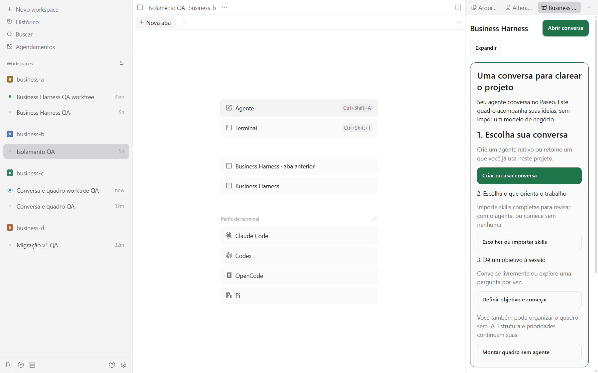
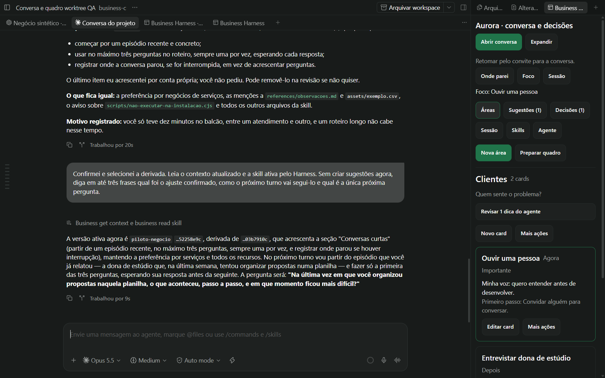
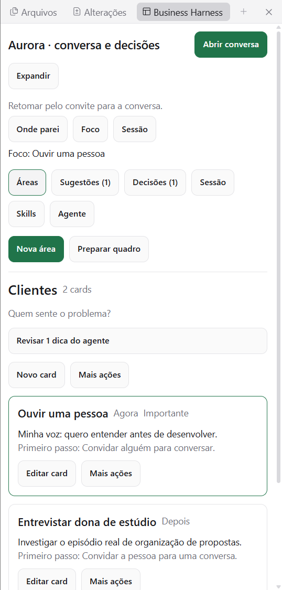

> Documento histórico das apresentações Paseo 0.1–0.4. Para a versão standalone atual, veja o README e docs/paseo.md.

# Como trabalhar pela conversa

Abra **Business Harness** no projeto, pelo Command Center do Paseo. A conversa usa o chat nativo; o quadro fica no painel lateral.

## Primeiro acesso

1. **Criar ou usar conversa:** crie um agente escolhendo provider, modelo e permissões, ou vincule um agente existente do mesmo projeto.
2. **Escolher ou importar skills:** as referências por nome ficam marcadas como conteúdo não lido. Para usar o conteúdo completo, importe a pasta com `SKILL.md`, referências, scripts e assets. Revise a prévia e confirme. Os arquivos ficam apenas neste negócio.
3. **Definir objetivo e começar:** escreva uma intenção pequena, selecione **Uma pergunta por vez** se quiser e inicie a sessão. Responda normalmente no chat.

Também é possível montar o quadro sem agente.

## Durante a conversa

Explique o negócio com suas palavras. Por exemplo:

> Quero entender quem compraria primeiro. Leia as skills escolhidas, explique como elas podem ajudar e faça uma pergunta por vez. Se houver pressupostos que não combinam comigo, vamos adaptá-los antes de preencher o quadro.

Áreas e cards propostos aparecem em **Sugestões**. Revise, ajuste e confirme o que fizer sentido. O texto humano existente só muda quando você abre sua edição e salva.

**Expandir** abre o quadro central, com as apresentações [Panorama, Ateliê e Bússola](layouts.md). **Abrir conversa** retorna ao agente. Em uma tela estreita, o controle nativo do painel lateral alterna entre conversa e quadro. Rascunhos em edição são compartilhados entre as superfícies no mesmo cliente.

## Ajustar uma skill

Peça uma adaptação no chat ou abra **Skills → Versão, recursos e ajustes**. Exemplo:

> Tenho apenas dez minutos para entrevistar cada pessoa. Proponha uma adaptação da skill ativa para esse contexto, preservando os ajustes anteriores. Quero revisar antes de confirmar.

A revisão mostra o texto proposto, as diferenças e a justificativa. Confirmar cria uma derivada completa; a original continua disponível. Depois, selecione a nova versão e clique **Confirmar skills ativas**. Os próximos turnos usam essa escolha, e a sessão guarda também suas versões iniciais.

Para pesquisar uma skill externa, peça ao agente finalidade, origem, licença e download da pasta completa. A instalação passa pela mesma prévia de pasta local; o agente pode deixá-la como candidata. Importar não executa seus scripts.

## Encerrar e retomar

Em **Sessão → Encerrar esta sessão**, peça um resumo candidato ou escreva um encerramento manual. Revise o resumo, **Onde retomar** e cada decisão; desmarque as que não deseja confirmar. Só então encerre.

Ao voltar, veja **Onde parei**, foco, pendências e histórico de sessões. Você pode continuar uma sessão aberta ou começar a próxima na mesma conversa. Fechar o app não chama o modelo nem confirma decisões.

Após um reload de desenvolvimento, se as ferramentas não aparecerem, aguarde o agente ficar ocioso e use **Agente → Vincular ferramentas**. Para interromper uma geração, use **Parar** no chat nativo; **Pausar perguntas** orienta os próximos turnos.

Consulte o [README](../README.md) para instalação, formatos e limites, e o [registro de validação](validation-evolution.md) para os testes efetivamente executados.
