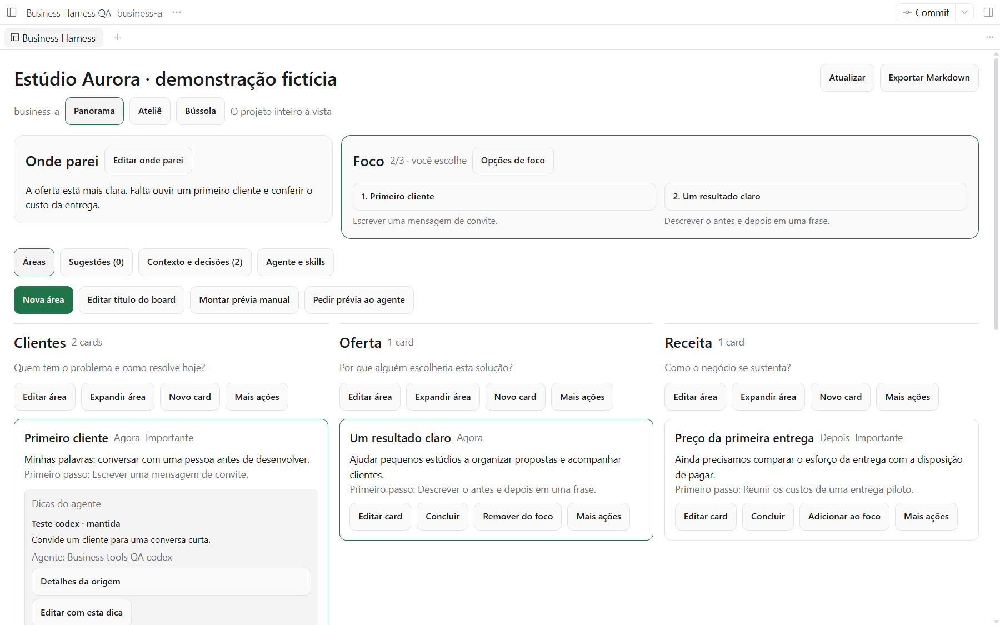
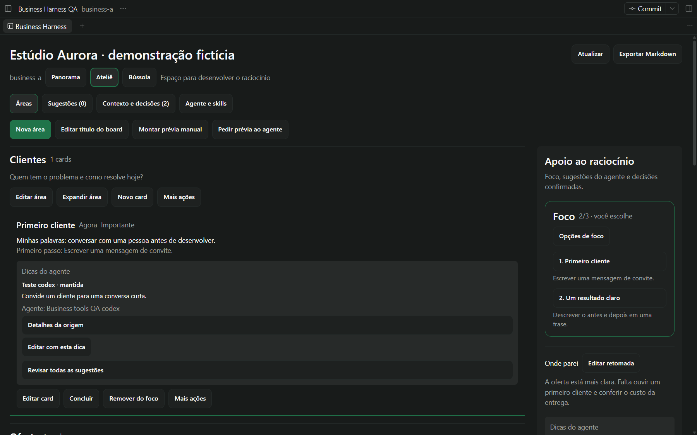
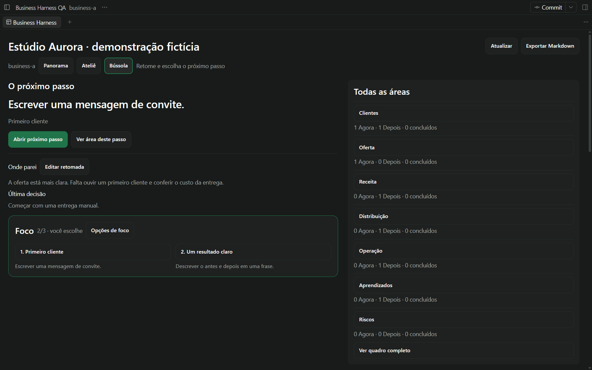
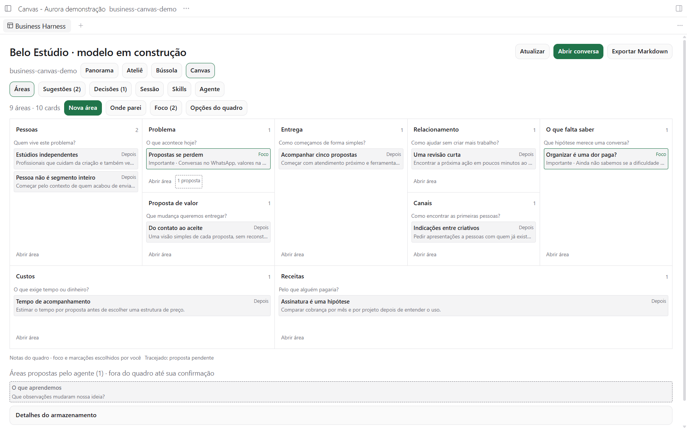
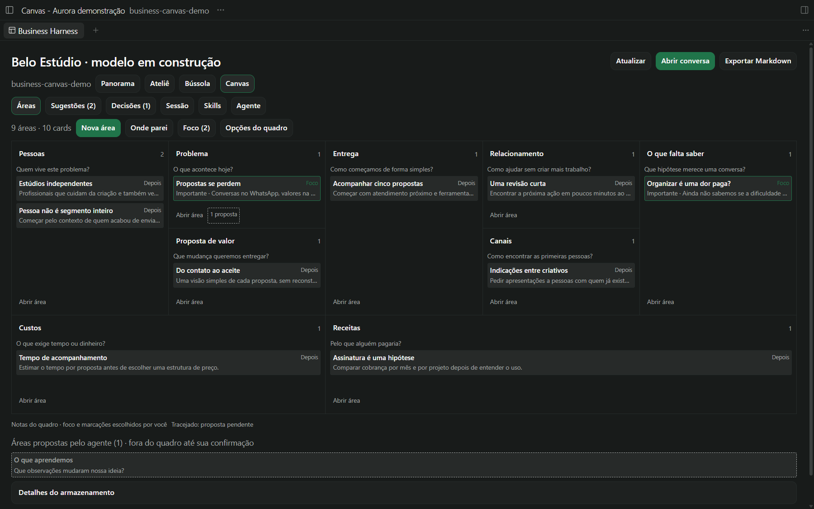
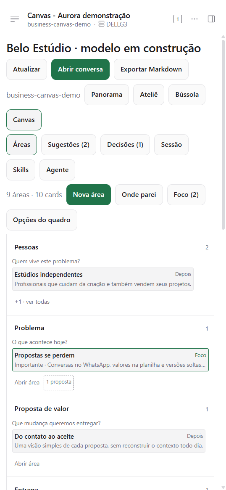

> Documento histórico das apresentações Paseo 0.1–0.4. Para a versão standalone atual, veja o README e docs/paseo.md.

# Quatro maneiras de trabalhar no mesmo quadro

As imagens abaixo são capturas do plugin executando no Paseo 0.15.4, com um negócio **fictício** de teste. As quatro opções estão no seletor do próprio painel expandido, sem instalação separada. A preferência pertence à aba; o conteúdo do negócio é o mesmo. As capturas das três primeiras apresentações registram a versão 0.1; a validação da nova apresentação está em [Canvas 0.3](validation-canvas.md).

## Panorama

Para percorrer as áreas e perceber lacunas. A grade passa de três para duas ou uma coluna conforme a largura disponível. Conteúdo humano e sugestões mantidas permanecem distinguíveis.

[Ver Panorama no tema escuro](screenshots/panorama-dark.png).

## Ateliê

Para desenvolver uma área com mais espaço de leitura e apoio ao lado: foco, onde parei, sugestões e decisões. Em largura estreita o apoio vira uma seção recolhível. Abrir uma área concentra a edição sem criar outro modelo de dados.

## Bússola

Para voltar depois de alguns dias: primeiro passo e foco escolhidos por você, onde parei, última decisão e índice de todas as áreas. Nenhuma prioridade é calculada pelo agente.

## Canvas

Para enxergar o projeto como uma folha de áreas contíguas e notas resumidas. Em vez de uma grade de painéis independentes, as divisórias formam o conjunto. A ordem atual define a composição; áreas não recebem nomes obrigatórios nem são encaixadas por significado. Com 7–9 áreas, a folha usa cinco colunas superiores e dois blocos largos inferiores. Outros totais continuam acessíveis em linhas equilibradas.

Notas mostram título e uma linha de texto. Marcas de foco e estados continuam humanos; propostas pendentes têm tracejado e áreas candidatas ficam fora do conteúdo confirmado. Toque na área/nota para editar pelo formulário existente. O contador **+N · ver todas** abre o detalhe completo, preservando os itens que não cabem no resumo. Em telas estreitas, use a lista ou duas colunas de resumos e abra uma área para trabalhar.

Retomada e foco ficam na barra compacta. A escolha de Canvas não altera o arquivo do quadro e não cria um template. Referências: [LeanSpark](https://leanspark.ai/leancanvas), [Strategyzer Canvas](https://www.strategyzer.com/library/the-business-model-canvas) e [Strategyzer Platform](https://www.strategyzer.com/platform). Consulte o [registro de validação 0.3](validation-canvas.md) para capturas e verificações reais.

## Como comparar

Use o mesmo quadro nas quatro apresentações. Em cada uma, tente localizar uma pendência, abrir seu contexto e identificar um primeiro passo. Troque de apresentação com um rascunho aberto: ele permanece na mesma edição. A escolha deve facilitar seu trabalho; não há necessidade de escolher uma opção definitiva.

A revisão visual usou princípios do [Impeccable](https://github.com/pbakaus/impeccable): hierarquia clara, estados de interação, cores com função e composição responsiva. Foram consultadas as instruções públicas; seu launcher e suas skills não foram instalados. Tokens de cor vêm do tema do Paseo. Consulte [DESIGN.md](../DESIGN.md) e o [registro de validação](validation.md).
