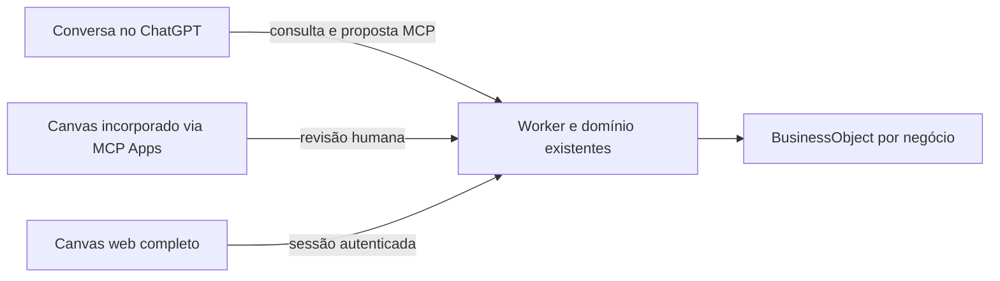

# Canvas aprovado e próximo passo: ChatGPT + MCP + web

Registro de encerramento e recomendação de produto,22/11/2026. Este plano não executa nem autoriza deploy, migração, instalação de integração ou chamada paga.

## Encerramento da etapa local

O usuário aprovou o resultado do Canvas e pediu finalizar esta etapa. Aceite qualitativo registrado em22/11: não foi informado quais provedores ou combinações de tema/tamanho ele usou; não atribuir a esse aceite uma matriz manual que não foi relatada.

Entregue em `feat/canvas-cli-local`, a partir de `main`5704053:

- Estudos comparativos em `design-lab/mapa-vs-canvas/` e direção aprovada em `design-lab/canvas-principal/`.
- Laboratório persistente em `design-lab/canvas-agente/`: nove blocos, edição, conversa por bloco ou Canvas inteiro, propostas na conversa, revisão antes/depois e aprovação humana de criação/alteração/próximo passo.
- Reuso do domínio v3, pareamento, writer, revisão/fingerprint e recibos. Sem schema/endpoints novos para esse fluxo. Cancelar, deadline de três minutos e uma consulta por vez no Ask.
- Últimos checks de implementação, em21/11 sobre5704053 +diff (`dirty=true`): typecheck e build aprovados; `npm test` no PowerShell127/127; harness de integração14/14, com processos falsos para os dois formatos de CLI. Capturas em1440/390, claro/escuro, incluindo revisão antes/depois. Detalhes e falhas iniciais em `design-lab/canvas-agente/LEIA-ME.md`.
- Em22/11 o ambiente foi retomado para teste do usuário. Essa retomada não executou outra bateria nem acionou inferência pelo implementador.

Os dados e logs de teste permanecem em `.local/`; não entram nos commits. O plugin e o daemon principais não foram atualizados por este trabalho. O pacote continua0.5.0: não tratar os commits como release publicada. A PR UI-01 permanece independente.

## Direção proposta

**Hipótese de uso do usuário:** a maioria dos clientes trabalhará pelo ChatGPT, usando MCP e uma interface web. Isso muda a prioridade de entrega em relação à sequência inicialmente centrada no Paseo; não é ainda uma medição de adoção.

**Recomendação:** ChatGPT como conversa principal; Canvas web como interface visual; backend cloud existente como fonte canônica desse modo. CLI local e Paseo ficam disponíveis como integrações complementares. Não criar outro chat com chamadas a modelos no servidor para reproduzir uma conversa que o cliente já tem no ChatGPT.

A aprovação continua explícita: **conversa → proposta pendente → revisão → aplicar → releitura do estado canônico**. O modelo não recebe uma ferramenta irrestrita para confirmar suas próprias propostas.

## Fatos verificados no código

| Parte existente | Local | Consequência |
| --- | --- | --- |
| MCP cloud autenticado, contexto e proposta tipada | `cloud/src/mcp/server.ts` | Reutilizar `business_get_context`, `business_query`, `business_submit_proposal` e `business_show_map`; não copiar o servidor localhost |
| Interface MCP Apps | `cloud/widget/main.tsx`, `cloud/widget/transport.ts` | Já existe ponte com host, leitura de snapshot, propostas e revisão; o desenho atual é mapa genérico, ainda não o Canvas aprovado |
| Confirmação pela UI | `cloud/src/mcp/server.ts`, `cloud/widget/transport.ts` | Métodos app-only e capabilities em `_meta`; preservar validação do lado servidor e não expor capabilities no texto/contexto do modelo |
| Fonte canônica cloud | `cloud/src/business/object.ts` | Durable Object com SQLite, transações, revisão, recibos e auditoria; não substituir por outro banco para copiar o laboratório |
| Sessão e autorização | `cloud/src/features/pilot/`, `cloud/oauth/` | Reaproveitar e verificar compatibilidade atual; código existente não prova login/host funcionando na conta do usuário |
| Infraestrutura | `cloud/wrangler.jsonc` | Workers, DO, D1 de identidade, KV e R2 já configurados. Não acrescentar serviços por padrão |

O board do laboratório local e o negócio cloud são fontes independentes. Não há sincronização automática. A etapa seguinte começa com negócio fictício cloud, sem importar ou sobrescrever o board local do usuário.

Também há diferença entre contratos: o laboratório usa `card_draft` e sugestões locais; o cloud usa propostas de comandos tipados. Reaproveitar o comportamento de revisão, traduzindo para o contrato cloud existente, sem transportar a capacidade humana local ou expor um comando genérico de escrita ao modelo.

## Compatibilidade confirmada pela documentação atual

**Fato documental:** ChatGPT suporta UI fornecida pelo MCP através do padrão MCP Apps, em iframe, associada por `_meta.ui.resourceUri` e ponte JSON-RPC `ui/*`. As ferramentas devem continuar úteis se a UI não renderizar. Portanto, um servidor só com ferramentas não cria o Canvas interativo automaticamente. [UI de MCP no ChatGPT](https://developers.openai.com/plugins/build/chatgpt-ui#start-with-mcp-apps).

**Fato documental:** dados entre conversas/dispositivos devem ficar no servidor e vinculados ao usuário autenticado; estado de widget não é banco do negócio. [Estado persistente](https://developers.openai.com/plugins/build/chatgpt-ui#store-cross-session-state-on-your-server).

**Fato documental:** o fluxo autenticado exige OAuth2.1 conforme autorização MCP; verificar issuer, audience/resource, validade e scopes a cada requisição. Preservar a separação entre autenticação do cliente e autorização do usuário/negócio. [Autenticação](https://developers.openai.com/plugins/build/auth#custom-auth-with-oauth-21).

**Fato documental:** o teste de conexão customizada no ChatGPT usa endpoint HTTPS`/mcp`, autenticação e instalação/conexão do plugin. A disponibilidade efetiva na conta/workspace e o comportamento da UI precisam de prova no host. [Conexão no ChatGPT](https://developers.openai.com/plugins/build/app-quickstart#connect-your-mcp-server-in-chatgpt).

Fontes consultadas em22/11/2026. ChatGPT é serviço sem versão fixa. No checkout analisado: MCP SDK1.32.2, MCP Apps2.0.4, Agents0.33.0, OAuth provider1.2.4 e React19.3.0 (`cloud/package.json`). Não foi feito upgrade ou instalação. As páginas oficiais foram lidas, não apenas resultados de busca.

## Próxima fatia recomendada

**Objetivo:** demonstrar um negócio fictício com o Canvas aprovado no site e no componente ChatGPT, usando o backend/propostas já existentes e os mesmos dados.

1. Extrair a apresentação dos nove blocos para componente DOM/React compartilhado entre site e widget. Portar estilos/interações aprovados; não embutir o HTML do laboratório com chamadas localhost no iframe.
2. Oferecer um preset BMC explícito para negócio de teste. Não mapear nove seções arbitrárias de um negócio existente por posição, nem renomear dados automaticamente. Preservar mapas genéricos. Se isso exigir schema novo, parar essa parte e resolver o contrato v3/M3 antes de alterar `shared/`.
3. No ChatGPT, aproveitar a conversa do host: consultar contexto, criar proposta tipada, mostrar Canvas/preview e aprovar pela UI. Usar seleção/contexto e mensagens da ponte MCP Apps quando necessário. Não duplicar o painel de chat do laboratório dentro do widget.
4. Começar a UI incorporada com leitura, seleção e revisão de propostas. Manter edição manual completa no site. Expandir edição incorporada apenas depois da prova do fluxo principal. Em largura estreita, usar blocos empilhados ou foco em um bloco, com acesso ao site; fullscreen só quando o host anunciar suporte.
5. Rodar os testes locais cloud e preparar prova em staging com dados fictícios. A conexão real no ChatGPT/HTTPS/OAuth só ocorre após autorização para essa etapa externa; não abrir túnel, expor porta ou publicar automaticamente.

### Critérios de aceite da próxima fatia

- A conversa identifica o negócio autenticado e lê seus nove blocos.
- Pedido de nova ideia cria proposta pendente; nada muda antes de confirmar.
- Pedido de alteração mantém o ID do cartão e preserva prioridades/vínculos não alterados.
- Próximo passo usa `firstStep`, sem criar sistema paralelo de tarefas.
- Após confirmar no componente, o site mostra a mesma revisão/conteúdo canônico. Reabrir uma conversa não inicia outro negócio nem perde o estado salvo.
- Rejeição não muda cartões; retry não duplica execução; revisão antiga conflita em vez de sobrescrever silenciosamente.
- Outra conta/negócio não lê nem aplica a proposta; modelo/caller externo não obtém capabilities humanas.
- Sem componente renderizado, consulta/proposta continuam úteis e a revisão abre no site, com autenticação e sem tokens em URL.
- Desktop/compacto e claro/escuro funcionam. O frontend não exige instalar Paseo/Codex/Claude no computador do cliente.

Validação prevista, respeitando `cloud/AGENTS.md` e os scripts existentes: `pnpm --dir cloud build`, `pnpm --dir cloud typecheck`, `pnpm --dir cloud test`, `pnpm --dir cloud test:ui`; depois teste manual no ChatGPT e no site. Esses comandos e a prova no host **não foram executados neste fechamento**. Não representam garantia de conexão já funcional.

## Fora da próxima fatia

Sem agentes permanentes, orquestrador próprio, sincronização cloud/local, migração de negócios reais, billing novo, publicação em catálogo, versão Paperclip ou aprofundamento VPC persistente. Não acrescentar modelo de cenários/versões/experimentos antes de estabilizar este caminho principal. A hipótese de uso predominante no ChatGPT deve ser observada no piloto, sem transformar concordância de IA em validação de mercado.
