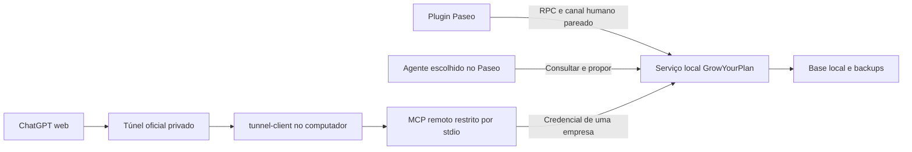

# Plano do MVP GrowYourPlan no Paseo e no ChatGPT

Data: 19 de novembro de 2026. Estado: plano para execução; produto e conexões ainda não implementados por esta frente.

Atualização de 20/11/2026: o M1 está concluído e o M2 foi comprovado no ChatGPT web com dados fictícios. A leitura e a proposta pendente funcionaram. O "erro claro com túnel desligado" ficou parcial e segue para o M7. Resultados, decisões e pendências estão em [M1-M2-BASELINE.md](M1-M2-BASELINE.md).

Preparado pelo host com análise do Claude Opus 5.5 e confronto com o código existente. Base inspecionada: `feat/ui-01`, `8aac5e3a305cbaedc40ccfac5debf94c2d9f820e`. O plano não integra a PR UI-01, não autoriza deploy e não reativa as antigas frentes S0–S8.

## 1. Resultado que vamos entregar

Um plugin local com organização visual inspirada no Flowly, em que o fundador acompanha áreas do negócio, ideias, sessões, decisões e um painel simples configurável. O ChatGPT web consulta esse mesmo negócio e envia uma ideia candidata; a pessoa vê a prévia e confirma no Paseo. Uma ideia confirmada deve continuar disponível depois de fechar e reabrir a interface, sem depender do histórico da conversa.

O MVP é de uso pessoal e instalação privada. As funcionalidades de uma empresa não dependem de criar conta GrowYourPlan, servidor cloud próprio ou novo motor de IA. A seleção de agentes continua no Paseo, respeitando a configuração e os limites dos provedores do usuário.

### Incluído

- Uma empresa por projeto/pasta Paseo, com identificação visível e isolamento entre projetos. Navegar para outro projeto não muda a raiz de uma conexão ChatGPT já concedida.
- Áreas livres e mapa existente preservados; métodos e modelos de organização continuam opcionais.
- Ideias com fontes, histórico, motivos reais de adiamento/rejeição e condição opcional para retomar.
- Sessões com objetivo e agente escolhido, ligadas às ideias e decisões.
- Painel com catálogo fechado: indicador, lista e nota. Adicionar, remover, renomear e reordenar; grade responsiva, sem editor de código.
- Indicadores com valores manuais ou propostos para confirmação, fonte, unidade e período. Listas usam dados internos.
- Inicialização e reconexão guiadas do serviço local, com mensagens de incompatibilidade e recuperação.
- Assistente para conectar o ChatGPT por túnel oficial, verificar a conexão e revogar o acesso.
- ChatGPT: consultar contexto delimitado, buscar registros e propor uma ideia. Não confirmar alterações, executar código ou controlar o Paseo.

### Etapa seguinte, fora do aceite deste MVP

Prévia visual e confirmação dentro do ChatGPT; gráficos e filtros avançados; arraste livre/redimensionamento do painel; integrações de marketing, CRM, bancos e formulários; simulações; sincronização; colaboração; publicação no diretório público do ChatGPT; OAuth/relay próprio; fork do Paseo; billing e deploy cloud. Essas possibilidades não serão implementadas como abas vazias.

## 2. Arquitetura e limites

O serviço local continua sendo o único escritor. UI, CLI e agentes usam os mesmos validadores, propostas e comandos; não haverá um segundo banco do ChatGPT nem escrita direta do plugin no JSON. O processo MCP remoto adapta o transporte, não mantém uma segunda versão do negócio.

O plano distingue três camadas:

1. **Dados:** ideias, fontes, sessões, decisões, indicadores e leituras.
2. **Configuração de apresentação:** lista ordenada de blocos do painel, ligada à empresa e persistida separadamente dentro do modelo. Não contém cópias das métricas.
3. **Execução:** comandos validados, identidade do canal, revisão, recibos e confirmação humana.

O painel salvo é compartilhável entre as interfaces futuras e pode receber propostas. Foco, aba aberta, rolagem e rascunhos de edição continuam preferências locais por negócio; não viram eventos estratégicos.

### Base já encontrada no código

| Base | Caminhos | Uso no MVP |
|---|---|---|
| Schema v3, reducer, integridade e fontes | `shared/model.ts`, `shared/evolution.ts` | Evoluir com compatibilidade explícita |
| Persistência, proprietário único e backups | `server/store.ts`, `server/ownership.ts`, `local/server.ts` | Preservar a autoridade de gravação |
| Inicialização do serviço | `local/cli.ts`, `local/control.ts` | Reaproveitar `ensureService`, separando a lógica dos efeitos da entrada CLI |
| Pareamento e capacidades | `server/service-client.ts`, `server/service-runtime.ts`, `SECURITY.md` | Manter edição humana separada da proposta de agente |
| MCP stdio e HTTP | `local/mcp.ts` | Primeiro experimento de transporte; depois perfil remoto restrito |
| UI nativa, sessões e observação | `index.client.tsx`, `client/board.tsx`, `client/ui.tsx`, `client/sessions.tsx`, `shared/observations.ts` | Aproveitar shell, componentes e polling compartilhado; criar módulos menores |
| Ferramentas e vínculo ao projeto | `index.server.ts`, `server/project.ts` | Reusar verificação de projeto/agente |
| Web local e cloud | `web/`, `cloud/` | Preservar funcionamento e dados; não copiar DOM para a UI nativa |

O manifest e os SDKs fixam 0.15.4, mas isso não comprova a versão do daemon e do app em execução. A documentação atual descreve APIs posteriores e limita os módulos permitidos no client. O primeiro marco verifica a combinação real, sem atualização geral automática. [Referência Paseo](https://paseo.sh/docs/plugins/reference.md).

## 3. Decisões adotadas para planejar

- Primeiro público: o próprio usuário, Windows desktop; verificar também largura compacta e temas. Compatibilidade de Android é um teste de cliente, não a criação de um app Android novo.
- Uma empresa/projeto/pasta e um agente local vinculado por vez. Não impor departamentos; trocar agente é uma ação explícita e preserva a sessão.
- Interface própria inspirada no Flowly; não copiar seu código, dados ou mecanismos internos.
- Interface nova prioriza inglês em dicionário, mantendo pt-BR e conteúdo do usuário intactos.
- O mapa nativo atual permanece acessível. A versão livre React Flow do navegador não será portada neste MVP; a UI-01 cloud permanece independente.
- Ideias e painel novos ficam inicialmente no Paseo. O web local deve conseguir ler/gravar sem eliminar seus dados, mesmo sem oferecer as novas abas.
- Fonte informada é rastreabilidade, não prova de verdade. Resultado sintético nunca se apresenta como evidência de clientes.
- A primeira conexão remota aceita apenas consulta e `idea_draft`. Outros tipos remotos serão liberados individualmente depois de necessidade e testes, não por herdar o enum local inteiro.
- Sem atualizações de métricas que invoquem IA. O agente só é usado quando a pessoa solicita análise ou proposta.

## 4. Frentes, dependências e entregas

Complexidade é relativa: pequena, média ou alta. Não representa prazo. A execução usa uma única branch de trabalho e entregas pequenas; testes de conta externa podem exigir ação do usuário, sem bloquear todo o desenvolvimento local.

| Frente | Entrega | Depende de | Complexidade |
|---|---|---|---|
| M1 | Baseline e decisão de compatibilidade | Nenhuma | Pequena |
| M2 | Prova inicial do túnel no ChatGPT real | M1 | Média, dependente da conta |
| M3 | Modelo, migração e proteção dos dados | M1 | Alta |
| M4 | Inicialização, pareamento e recuperação | M1 | Média |
| M5 | UI estilo Flowly, ideias e sessões | M3, M4 | Média |
| M6 | Painel configurável e indicadores | M3, shell M5 | Média |
| M7 | Acesso remoto restrito e assistente de conexão | M2, M3, M4 | Alta |
| M8 | Aceite integrado, pacote e documentação | M5, M6, M7 | Média |

Ordem prática: M1 → M2 → M3 → M4 → M5 → M6 → M7 → M8. Em M1, um esboço visual pode orientar M5; não precisa esperar a infraestrutura. Se M2 depender de permissão ainda ausente, M3–M6 podem avançar, mas a entrega completa continua pendente de ChatGPT real.

### M1. Fixar a base e os riscos antes de editar produto

**Entrega:** ficha de runtime/branch, contratos existentes e resultado da baseline; fluxo visual das abas e estados vazios. Conferir alterações locais, instruções, PR UI-01, serviços e executáveis realmente usados. Não trocar branch enquanto um serviço depender do checkout. Planejar uma única branch `feat/plugin-mvp` após resolver essa dependência; não criar worktrees extras, não integrar a PR cloud implicitamente e não trocar a base em silêncio.

Verificar versões do daemon, app e SDK; validar o plugin atual numa instância de teste. Preferir APIs já compatíveis; se o runtime exigir upgrade, fazer uma fatia exclusiva com manifest e testes, sem confundir instalação com atualização segura.

Fixtures ficam em diretório de teste dentro do workspace autorizado, ignorado pelo Git, ou nos diretórios temporários geridos pelos testes. Nunca ler mapas privados para popular demonstrações. Registrar apenas metadados necessários dos serviços, sem imprimir argumentos ou configurações que contenham tokens.

**Aceite:** baseline conhecida, compatibilidade decidida, raiz de teste isolada, nenhum serviço de trabalho interrompido. Um esboço contempla Painel, Áreas/Mapa, Ideias, Sessões/Decisões e Conexão, sem páginas placeholder para funcionalidades futuras.

**Verificação futura:** scripts raiz `npm run typecheck`, `npm test`, `npm run build`; status/diff; inspeção do plugin no cliente real. Falhas preexistentes ficam identificadas antes da implementação.

### M2. Comprovar o caminho ChatGPT → túnel → base local

**Entrega:** experimento pequeno com o MCP existente e uma empresa fictícia, antes de investir em relay ou UI de conexão.

A documentação oficial oferece túnel de saída para MCP stdio/HTTP, com permissões e associação entre organização e workspace. Requer `tunnel_id`, chave de runtime e cliente ativo. É uma opção privada, não o caminho de publicação pública. Disponibilidade, permissões e custos da conta do usuário precisam ser verificados; exigir uma chave não prova cobrança de inferência. [Secure MCP Tunnel](https://developers.openai.com/api/docs/guides/secure-mcp-tunnels).

Usar o CLI local compilado, com caminho absoluto, raiz fictícia fixada e comandos derivados do `--help` instalado. Não depender de um `business` global possivelmente antigo. O experimento pode usar a superfície MCP existente apenas com dados fictícios e acesso privado controlado; o produto só usa o perfil restrito de M7.

Configurar pela interface oficial uma conexão privada e comprovar `business_get_context` e uma proposta existente, ainda sem o novo domínio de ideias. Guardar resultado e ID da proposta no teste local; não alegar que isso já valida `idea_draft`. A ferramenta de escrita do ChatGPT pode pedir confirmação para **enviar** a proposta; isso não é confirmação para aplicá-la ao negócio. [Conexão de MCP no ChatGPT](https://developers.openai.com/api/docs/guides/custom-mcp-server).

**Aceite:** chamada observada no ChatGPT web, `boardId` correto, proposta pendente visível localmente e erro claro com túnel desconectado. Inspector MCP, teste localhost e screenshot da tela de configuração não substituem a chamada real.

**Se falhar:** registrar etapa, erro e requisito ausente. Não construir relay automaticamente. Uma alternativa HTTPS autenticada exige decisão explícita de escopo. O plano do núcleo local continua, sem declarar o MVP integrado concluído.

### M3. Modelo e migração protegida

**Entrega:** schema local v4, compatibilidade v1–v3, comandos e derivadores puros. Congelar definições legadas antes de estender o schema atual; não deixar schemas antigos herdarem campos novos obrigatórios.

Modelo mínimo proposto:

| Registro | Conteúdo mínimo |
|---|---|
| Ideia | ID, título/texto, vínculos a áreas/cards, fontes, sessão opcional e status |
| Histórico de ideia | Evento, data, autor/canal, motivo e condição opcional para retomar |
| Indicador | ID, nome, unidade/moeda quando cabível, definição, cadência opcional e arquivamento |
| Leitura | ID, indicador, valor finito, período ou instante, fonte, registro/confirmação e correção opcional de outra leitura |
| Painel | Versão do formato e blocos ordenados: indicador, lista predefinida ou nota |
| Decisão | Registro existente acrescido de vínculos às fontes e sessão quando houver |

Status iniciais: aberta, explorando, adiada, rejeitada e adotada. Adiar/rejeitar exige motivo informado; o agente não preenche justificativa inventada. Voltar ao status anterior acrescenta evento. Arquivar preserva pesquisa e referências; exclusão permanente não faz parte da primeira UI.

Uma correção de leitura acrescenta registro que substitui o anterior, sem apagá-lo. Não comparar automaticamente unidades diferentes, saldo com faturamento ou períodos incompatíveis. Variação percentual com base zero fica indisponível; ausência de dado não vira zero. Data de coleta, período e momento da confirmação são coisas distintas.

Comandos iniciais: salvar/alterar status/arquivar ideia; salvar/arquivar indicador; acrescentar/corrigir leitura; alterar/restaurar painel. Propostas locais: ideia, indicador, leitura e painel. Aplicar uma proposta valida novamente IDs, unidade, origem, revisão e integridade; proposta antiga exige prévia atualizada e nova confirmação, sem aplicar cegamente um snapshot antigo.

Antes de acrescentar v4, isolar obrigatoriamente o contrato v3 usado pelo cloud: `cloud/src/business/domain.ts` e `cloud/src/business/model.ts` importam schema/reducer do `shared/` raiz, e o domínio também usa seu exportador. Congelar o conjunto v3 e suas dependências em módulo versionado, atualizar os imports cloud e comprovar comportamento idêntico. Essa fatia não muda schema/dados/MCP cloud; regressões cloud são obrigatórias antes de prosseguir. Não basta trocar o literal do schema raiz.

Migração explícita pelo canal humano, backup v3 imutável e bloqueio de escrita com serviço incompatível. A confirmação inicial ocorre no visualizador web local existente (`web/src/App.tsx` e `/api/migrate`), com mensagem atualizada para o writer `business` antigo; o plugin mostra o estado e abre essa tela. Não acrescentar uma segunda UI de migração neste MVP. Atualizar contrato de saúde com versões/capacidades. Testar a build antiga contra v4, assegurando recusa sem regravação. Repetir o smoke de M2 após migrar sua fixture v3, pois propostas devem ficar bloqueadas enquanto houver migração pendente.

**Volume:** medir fixture com centenas de ideias e milhares de leituras; definir limites de tamanho, duração e quantidade a partir da baseline e do alvo de MVP. Contexto de IA será resumo limitado com consulta paginada. Não responder a desempenho ruim criando silenciosamente um segundo arquivo/banco sem transação e backup coordenados.

**Aceite:** migração preserva IDs e relações; inválidos e escritores antigos não alteram arquivo; correções/histórico sobrevivem à recarga. A exportação Markdown existente inclui as novas seções como leitura, sem prometer round-trip. Recuperação é procedimento documentado e testado a partir de backup canônico, com o serviço de teste parado e cópia preservada do arquivo substituído; importador e restauração pela UI ficam para depois. Sem segredos em backups do board ou exportações. Limites recusam operações com erro legível, sem perda silenciosa.

**Caminhos:** `shared/model.ts`, contrato v3 congelado e módulos novos de ideias/painel, `shared/evolution.ts`, `shared/export.ts`, `server/store.ts`, `local/server.ts`, `web/src/App.tsx` e imports cloud compatíveis.

### M4. Serviço local utilizável pelo plugin

**Entrega:** estados sem serviço, iniciando, precisa parear, conectado, incompatível e erro recuperável; ações para iniciar/reusar serviço, abrir autorização e reconectar.

Extrair a lógica de inicialização de `local/cli.ts` para módulo de servidor reutilizável sem efeitos colaterais da CLI. Usar o executável desta instalação, argumentos estruturados, janela oculta no Windows e a exclusão de escritor existente. Nunca matar processo por número de porta nem reiniciar daemon para carregar plugin.

Preservar o pareamento humano: credencial em memória e vinculada ao nonce do serviço. Reabrir navegador de autorização pelo botão do plugin pode reduzir atrito, mas token humano não vai para runtime, MCP ou settings. Pareamento totalmente persistente não entra como atalho. Se futuramente ampliarmos o canal de controle, isso requer mudança e teste explícitos do limite de confiança.

**Aceite:** cliques concorrentes geram um escritor; serviço já ativo é reutilizado; incompatibilidade bloqueia edição sem sobrescrever dados; reinício invalida sessão antiga e preserva rascunhos. Recarregar plugin não encerra serviço externo nem provoca dupla inicialização. Falha no PATH não importa quando o caminho do executável é conhecido.

**Caminhos:** `server/service-client.ts`, `server/service-runtime.ts`, módulo novo de lifecycle, `local/cli.ts`, `shared/rpc.ts`, `index.server.ts` e UI de conexão.

### M5. Interface, ideias, sessões e agente local

**Entrega:** shell visual inspirado no Flowly, com empresa claramente identificada, abas e cards legíveis. A tela principal é um painel amplo do Paseo; detalhes ficam em inspetor, sem depender de portabilidade de componentes DOM.

Adicionar módulos próprios para ideias e revisão, evitando aumentar o monólito `client/board.tsx`. Preservar mapa/áreas e histórico existentes. Títulos longos, fontes e motivos devem ser acessíveis sem cortar informação; layouts estreitos mantêm navegação e rascunhos.

Sessão começa com objetivo e agente selecionado. Ideias e decisões podem se ligar à sessão sem copiar toda a conversa para o board. Encerrar uma execução do agente não encerra a atividade de negócio; encerramento de sessão continua ação explícita. Troca de agente verifica projeto e não vincula automaticamente outro processo encontrado.

Agente local consulta contexto e propõe; humano edita prévia, confirma, rejeita ou adia. Fontes recebidas são conteúdo, não instruções de execução. O adaptador valida o agente no Paseo, mas hoje usa o mesmo `agentToken` dos demais clientes locais. Portanto, até existir uma credencial distinta para esse canal, o histórico do serviço mostra identidade local autodeclarada; não exibe selo de origem Paseo autenticada. A origem remota verificada em M7 identifica o grant, não o modelo nem a pessoa.

Reutilizar `ProjectObservations` de `shared/observations.ts`, já usado por `client/board.tsx` via `client/board-observations.ts`. Ele faz polling compartilhado com intervalo padrão de seis segundos e publica resultados locais. Vincular as novas abas à mesma observação por host/projeto, sem pollers duplicados; pausar observações sem consumidores e proteger rascunhos. Alvo de aceite em teste local saudável: proposta remota aparece em até dez segundos na aba aberta, sem clique em atualizar; falha de rede mostra estado desatualizado. Subscription só entra se M1 comprovar compatibilidade e vantagem.

**Aceite:** conversa local produz ideia com duas fontes; ela aparece pendente, é revisada, adiada com motivo e reaberta intacta. Mudanças concorrentes preservam rascunho e pedem atualização. Tema claro/escuro, teclado e tamanho compacto funcionam. Abrir o chat leva ao agente existente do Paseo; não depende de SDK de chat embutido ainda não demonstrado.

**Caminhos:** `client/ideas.tsx`, componentes de revisão, `client/board.tsx`, `client/sessions.tsx`, `client/agent-setup.tsx`, `index.client.tsx`, `index.server.ts`.

### M6. Painel personalizável sem app builder universal

**Entrega:** catálogo de três tipos de bloco; lista ordenada vira grade responsiva. Botões de mover para cima/baixo dão personalização acessível. Arraste pode entrar depois, sem condicionar o aceite.

- Indicador: valor confirmado, unidade, fonte, período, atualização e histórico acessível.
- Lista: ideias por status, propostas pendentes, decisões ou sessões recentes e cards em foco; filtros são opções conhecidas, não SQL/YAML/código.
- Nota: texto de apoio ligado ao painel.

Cada bloco escolhe uma fonte disponível: dado interno ou indicador com leitura manual/confirmada. Não mostrar Google Ads, banco ou CRM como conectado sem conector real. Dados de demonstração só em ambiente explicitamente fictício.

O agente local pode propor uma configuração de painel. A prévia usa dados existentes e estado vazio honesto. Aplicar e desfazer são comandos validados; definir retenção limitada de versões e impedir que desfazer de um cliente sobrescreva edição posterior de outro.

**Aceite:** adicionar/remover/reordenar, prévia, confirmar, desfazer e recarregar preservam o painel; troca de empresa não mistura seleção nem valores; abrir painel, buscar números e registrar leitura geram zero chamadas a providers. Cálculos e atualização são funções de dados, não prompts.

**Caminhos:** `client/panel.tsx`, `shared/dashboard.ts` ou equivalente, comandos/schemas e RPC existentes.

### M7. Credencial remota e assistente ChatGPT

**Entrega:** perfil MCP remoto restrito e tela guiada de configuração. M2 prova transporte; M7 torna esse transporte apropriado aos dados do produto.

O humano pareado concede acesso de leitura/proposta à empresa atual. Criar credencial própria, com identidade de conexão, escopo, revogação e raiz canônica. O serviço valida a credencial em cada chamada e carimba a origem. `sourceAgentId` recebido não autentica ninguém. A identidade de conexão não prova qual modelo ou pessoa digitou a mensagem.

O serviço guarda verificador/hash; o componente local que chama o MCP precisa guardar ou receber o segredo correspondente de modo protegido. Escolher mecanismo validado no sistema operacional; no Windows não assumir que chmod 0600 aplica ACL. Credenciais ficam fora do board, exportações, settings comuns, argumentos de processo e logs. O limite de confiança de processos do mesmo usuário continua documentado.

O perfil remoto fixa raiz e grant na inicialização. Expõe só:

1. `business_get_context`: resumo confirmado, identidade da empresa, revisão e limites/truncamento explícitos.
2. `business_query`: busca paginada nos registros autorizados, sem caminho arbitrário.
3. `business_submit_suggestion`: apenas `idea_draft` validado; retorna recibo e estado pendente.

Não expor skills/scripts, `skill_import`, importação/exportação, Ask, shell, arquivos, edição humana ou MCP geral do Paseo. Aplicar limites de tamanho/taxa/pendências e idempotência por identidade de conexão + requestId + hash do conteúdo. A raiz fixa reduz o risco, mas não elimina erro de configuração: verificar grant da A contra B, alias de caminho, conexão trocada e cache de UI.

O assistente conduz quatro passos: escolher empresa → conceder acesso limitado → configurar túnel/conta pelos meios oficiais → testar chamada no ChatGPT. Mostrar separadamente serviço local, cliente do túnel, autorização e última chamada remota válida. `readyz` saudável não equivale a integração comprovada.

Preferir stdio com executável/raiz absolutos. Não expor a porta HTTP do serviço, nem passar o `agentToken` existente ao ChatGPT. A configuração inicial pode ser guiada/manual; não assumir API de provisionamento automático. O helper deve oferecer comandos corretos para PowerShell, diagnósticos sem segredo, portas de saúde sem colisão e instrução local de fornecimento da chave. Instalação/gestão automática do cliente só se a prova M2 e os controles de lifecycle a justificarem.

**Desconectar:** diferenciar parar o cliente, desligar a conexão no ChatGPT e revogar o grant. Não parar serviço utilizado pelo navegador/Paseo. Após reinício, grant revogado continua inválido; nova chamada não deve virar escrita aplicada. O túnel pode ter fila própria: não prometer fila inexistente nem reexecutar comandos silenciosamente. Retentativas usam os mesmos recibos e revalidam autorização.

**Aceite:** teste stdio do SDK lista só três ferramentas; payload proibido é recusado; grant A não funciona em B; revogação bloqueia a próxima chamada; contexto não contém tokens/caminhos/recibos internos; erro/offline não aparece como dado vazio. No ChatGPT real, ideia remota aparece pendente com origem da conexão.

**Caminhos:** `local/mcp.ts`, `local/cli.ts`, `local/server.ts`, módulos de grants/credenciais e contexto, `shared/rpc.ts`, `client/chatgpt-connection.tsx` e testes de transporte.

### M8. Aceite integrado, distribuição privada e operação

**Entrega:** pacote local instalável no Paseo, guia de conexão ChatGPT, diagnóstico, backups/restauração e evidências. Build de CLI/web não comprova que o bundle nativo carrega: testar instalação/reload do plugin em ambiente isolado e depois no host autorizado, sem restart geral.

Registrar versão do pacote, SHA, runtime testado, comandos/checks e limitações. Atualizar `OVERVIEW.md`, documentação de setup, `SECURITY.md` e criar `docs/chatgpt-tunnel.md` durante a implementação. Preparar PRs pequenas e revisão visual antes de merge; nenhuma publicação ou deploy automático.

**Aceite de operação:** abrir do zero por instruções reproduzíveis, parear, recuperar conexão e revogar sem editar JSON manualmente. Mostrar o procedimento de reautenticação, o efeito de suspensão do computador e a diferença entre serviço parado e chave expirada. A tela do computador desligado não pode renderizar estado: o cliente externo deve receber indisponibilidade.

## 5. Testes planejados e evidência exigida

Os comandos abaixo são existentes, salvo testes novos explicitamente identificados. São plano de execução, não checks já realizados nesta entrega documental.

| Camada | Comando ou procedimento | Verifica |
|---|---|---|
| Tipos | `npm run typecheck` | Plugin, compartilhado e web local |
| Domínio/persistência | `npx tsx --test server/tests/domain.test.ts server/tests/store.test.ts server/tests/evolution.test.ts` | Migração, invariantes, revisão e histórico |
| Adaptador/lifecycle | `npx tsx --test server/tests/remote.test.ts server/tests/project-state.test.ts server/tests/chat-entry-independent.test.ts` | Isolamento, pareamento e retomada |
| Serviço local | `npx tsx --test local/tests/standalone.test.ts` | Escritor único, HTTP, capacidades e persistência |
| Fonte da UI | `npx tsx --test server/tests/native-ui.test.ts` | Regras estáticas; não substitui inspeção visual |
| Regressão raiz | `npm test` e `npm run build` | Suíte raiz e pacote CLI/web |
| MCP remoto novo | Após criar `local/tests/remote-mcp.test.ts`: `npx tsx --test local/tests/remote-mcp.test.ts` | Tools/list, contrato, auth e proposta via stdio |
| Preservação cloud obrigatória na separação v3 de M3 e alterações posteriores nessa fronteira | `npx --yes pnpm@10.33.1 --dir cloud typecheck`, `npx --yes pnpm@10.33.1 --dir cloud test`, `npx --yes pnpm@10.33.1 --dir cloud build` | Compartilhamento não modifica contratos cloud |
| Plugin real | Instalar/recarregar ID correto com CLI suportada; inspecionar catálogo/log e UI em desktop/compacto/claro/escuro | Bundle, RPC, interação, navegação e rascunhos |
| ChatGPT real | Fluxo privado com conta autorizada, chamada expandida e recibo local | Conexão efetiva, mesma empresa e proposta pendente |

Executar testes pertinentes à fatia; suíte completa e build nos marcos de integração. Não repetir todas as suítes por mudança apenas documental. Usar scripts Paseo do projeto quando existirem, sem inventar script já registrado.

### Jornada final obrigatória

1. Criar duas empresas fictícias com IDs de elementos repetidos para testar isolamento.
2. No Paseo, registrar ideia, indicador e leitura; montar painel. Contador de chamadas de IA permanece zero nessas ações manuais.
3. Iniciar sessão com agente local e receber ideia/leitura candidatas. Nenhuma é aplicada automaticamente.
4. No ChatGPT web, consultar a empresa A e comparar `boardId`/revisão com o Paseo no mesmo instante.
5. Propor ideia com fontes no ChatGPT; ver a pendência no Paseo em até dez segundos no teste local saudável. Antes de confirmar, o conteúdo confirmado não muda, embora a revisão de estado possa avançar ao registrar a pendência.
6. Editar e confirmar a proposta localmente; recarregar interfaces e consultar de novo. Ver o mesmo ID e conteúdo persistidos.
7. Repetir requestId/payload: não duplicar. Reutilizar ID com conteúdo diferente: conflito explícito.
8. Criar proposta com revisão antiga: marcar desatualização, recalcular prévia e exigir confirmação sobre estado atual.
9. Tentar empresa B, tipo de proposta proibido e conteúdo com instrução maliciosa: nada amplia escopo ou concede edição.
10. Desconectar túnel, revogar grant e reiniciar serviço de teste: indisponibilidade/repareamento corretos, dados preservados e um escritor apenas.
11. Confirmar e desfazer configuração do painel; conferir que não apaga edição concorrente ou dados de origem.
12. Exportar Markdown legível e recuperar uma fixture a partir de backup canônico, com o serviço de teste parado; comparar ideias, fontes, histórico, leituras e painel após reabrir. Segredos não estão nesses arquivos. Não pressupor importador JSON ou restauração pela UI.

Guardar evidência por marco: SHA, versões, dados fictícios usados, comandos, resultados e capturas sem segredo. Não confundir testes simulados, consultas locais, demonstração no navegador e integração ChatGPT.

## 6. Recuperação e controle de risco

| Risco | Controle e reação |
|---|---|
| Runtime incompatível | Bloquear carga/edição com diagnóstico; fatia de compatibilidade antes das funcionalidades |
| Writer antigo descarta novos campos | Schema versionado, health handshake, backup imutável e teste com build anterior |
| Erro de migração | Não substituir original; recuperar da cópia verificada |
| Downgrade após dados v4 | Exportar/preservar snapshot v4 antes; restaurar backup v3 perde novidades posteriores e exige decisão explícita, nunca rollback automático |
| Grant vazado ou empresa incorreta | Escopo fixo, armazenamento protegido, revogação persistente e testes cruzados |
| Duas fontes de verdade | Proibir gravação direta por UI/MCP e persistência cloud paralela |
| Volume grande | Resumos/paginação e limites medidos; erro de capacidade sem truncar dados salvos |
| OAuth/túnel/conta indisponível | Erro por etapa e requisito faltante; não contornar proteção nem declarar integração validada |
| Regressão UI-01/cloud | Congelamento obrigatório do contrato v3 e regressão cloud antes de estender o modelo local |
| Fontes ou métricas incorretas | Origem/período visíveis, correções auditáveis, sem equiparar confirmação humana a verdade |

Os arquivos privados ficam no computador, mas resultados enviados ao ChatGPT são compartilhados com a OpenAI. O canal remoto só funciona com host e cliente de túnel disponíveis. Não prometer privacidade ponta a ponta contra o provedor do modelo, custo zero, disponibilidade contínua ou compatibilidade com qualquer conta.

## 7. Primeira ação e ponto de conclusão

Começar por **M1 e M2**, usando o MCP já existente e dados fictícios. Só após comprovar transporte e identificar a versão real do Paseo, fechar os contratos e avançar no restante.

Perguntas de conta são feitas quando necessárias para M2: qual workspace/organização usar e quais permissões existem. Preferências inferíveis não bloqueiam o plano: uma empresa por projeto, catálogo simples, revisão no Paseo e sem conectores externos.

O MVP está pronto quando a jornada completa da seção 5 passa no plugin real e no ChatGPT web, com uma única base local, proposta revisável, recarga e revogação comprovadas. O painel visual dentro do ChatGPT é uma entrega posterior, reutilizando contratos e criando widget web específico, não renderizando React Native no iframe. [UI opcional no ChatGPT](https://learn.chatgpt.com/use-cases/chatgpt-apps).

## 8. Contribuição do Opus e ajustes do host

O Opus examinou código, SDK instalado e documentação, propôs provas antecipadas, grants remotos, perfil MCP restrito e preservação do escritor único. O host incorporou isso e manteve personalização limitada do painel, parte do pedido do usuário.

A revisão final do Opus apontou dependência concreta do cloud no schema raiz, necessidade de confirmar migração no web, autoria local ainda autodeclarada e ausência de importador/restauração na UI; essas correções foram incorporadas. O host corrigiu um achado do parecer: já existe polling em `shared/observations.ts`, que será reutilizado e testado nas novas abas.

A síntese também evita transformar recomendações em garantias: raiz fixa não torna vazamento impossível; confirmação de ferramenta pode ser lembrada pelo ChatGPT e não substitui o canal humano do produto; permissões no túnel não autorizam endpoints HTTP anônimos; benchmarks e retenções precisam de medição; backup antigo não recupera dados criados depois dele; o transporte possui suas próprias filas/timeouts.

O parecer foi consultivo. As frentes acima ainda precisam de implementação e validação; nesta entrega foram feitas inspeção e documentação, sem iniciar serviços, instalar plugin, migrar mapas ou conectar contas.
