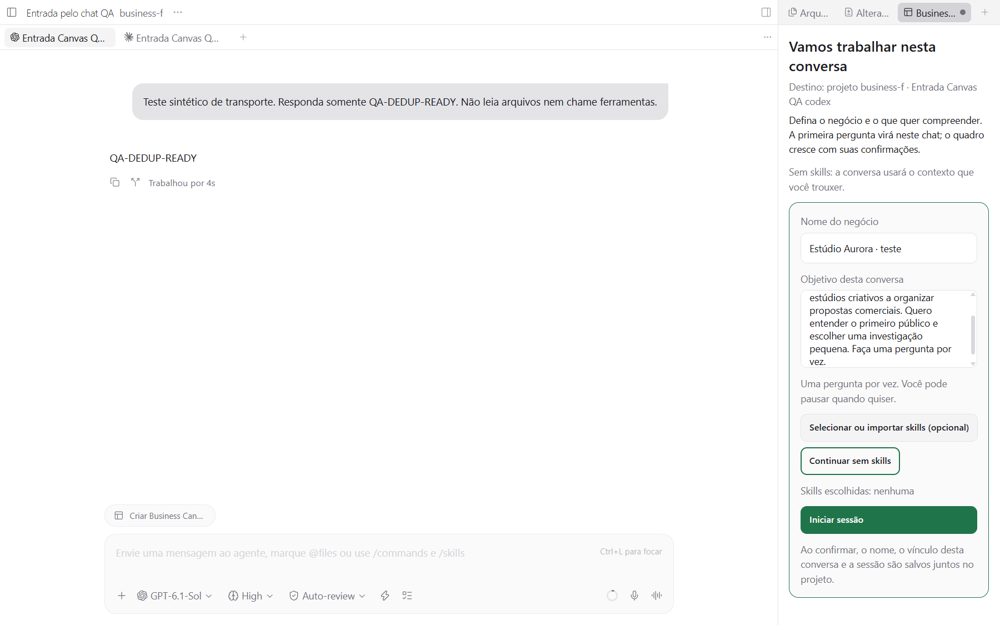
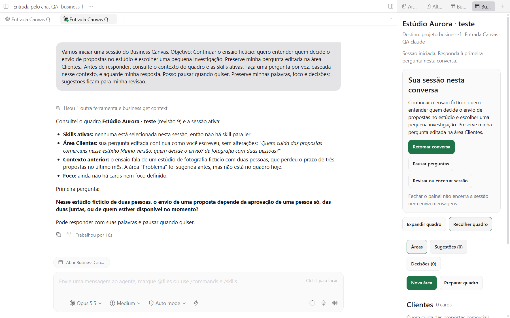

> Documento histórico das apresentações Paseo 0.1–0.4. Para a versão standalone atual, veja o README e docs/paseo.md.

# Começar pelo chat

Abra uma conversa do Paseo no projeto do seu negócio. O plugin usa essa conversa, o modelo e as permissões que ela já tem.

1. Junto à caixa de mensagem, clique em **Criar Business Canvas**. Se o projeto já tem quadro, o botão será **Abrir Business Canvas**.
2. Confira o projeto de destino. Preencha **Nome do negócio** e **Objetivo desta conversa**.
3. Se quiser, abra **Selecionar ou importar skills (opcional)**. Para experimentar primeiro, use **Continuar sem skills**.
4. Clique em **Iniciar sessão**. Aguarde a primeira pergunta e responda no chat, com suas palavras. O quadro fica ao lado.

O agente consulta o quadro e as skills escolhidas. A entrevista faz uma pergunta por vez; você pode usar **Pausar perguntas** e continuar a conversa livremente.

## Fazer o quadro crescer

Você pode pedir no chat: “Proponha poucas áreas para organizar o que conversamos”. Em **Sugestões**, abra **Revisar prévia**, edite títulos/perguntas e desmarque os itens que não quer. **Confirmar estrutura** cria somente as áreas selecionadas.

As sugestões permanecem separadas do conteúdo confirmado. Também é possível criar áreas e cards manualmente. Prioridades e foco são suas escolhas.

Use **Expandir quadro → Canvas** para ver a folha de blocos e notas. Panorama, Ateliê e Bússola continuam disponíveis sobre os mesmos dados. Em tela estreita, **Retomar conversa** volta ao chat; o botão **Abrir Business Canvas** reabre o painel.

[Tema escuro](screenshots/chat-entry-session-dark.png) · [Tela estreita](screenshots/chat-entry-narrow.png) · [Quatro apresentações](layouts.md).

## Retomar depois

Abra a conversa e clique em **Abrir Business Canvas → Retomar conversa**. Fechar o painel ou o aplicativo preserva a sessão salva e não envia mensagens. Para iniciar outra etapa, revise e encerre a sessão atual; depois use **Iniciar nova sessão nesta conversa**.

O projeto tem um quadro compartilhado entre seus workspaces e worktrees. Se houver uma sessão ativa em outra conversa, o painel oferece **Ir para a conversa da sessão**; abrir o quadro não troca o vínculo.

Se o agente estiver trabalhando, aguarde o turno terminar. Se aparecer uma tentativa de envio incerta, confira o chat antes de marcar a confirmação e tentar novamente. O plugin conserva a sessão e reutiliza o identificador da mensagem; nunca reenvia por conta própria.

Instalação e limites: [README](../README.md). Verificações desta versão: [validação 0.4](validation-chat-entry.md).
