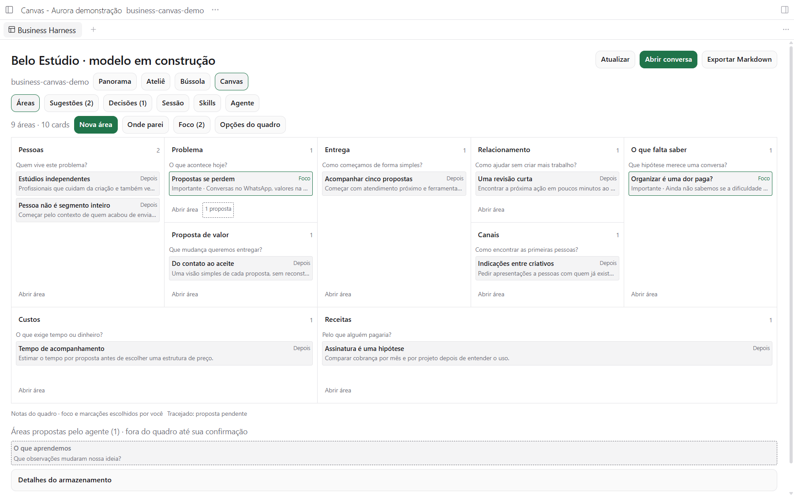

# Validação 0.3 — apresentação Canvas

Verificado em **14/11/2026**, Windows, Paseo e SDK **0.15.4**, no daemon isolado `127.0.0.1:6778`. A versão acrescenta uma apresentação ao fluxo [conversa primeiro](conversation-first.md); contratos de agente, persistência e schema 2 permanecem os da [versão 0.2](validation-evolution.md).

## Implementação e revisão

Claude Opus aconselhou a composição de folha, o resumo das notas e a separação visual das propostas. GPT‑6.1 Sol high implementou; outro Sol high revisou seleção, acesso aos cards, revisão de propostas e foco do teclado. O foco do teclado foi diferenciado da seleção e do foco humano com uma borda de 2 px. A inspeção no Paseo encontrou transbordamento de títulos nas notas; o limite de largura, a redução do texto e a elipse foram corrigidos antes das capturas finais.

A suíte passou com **62 testes**, zero falhas e zero skips, e o typecheck passou. Os testes de composição cobrem 3, 7, 9 e 15 áreas, larguras com diferentes limites de colunas, IDs, ordem, acesso aos cards omitidos do resumo e resolução da seleção. O Canvas reutiliza os editores e a revisão existentes; nenhuma coordenada foi acrescentada ao JSON.

## Verificações na interface real

O projeto de demonstração é **fictício**, separado dos projetos usados na validação de agentes. Suas duas propostas pendentes são fixtures de QA; as chamadas reais de Claude e Codex estão documentadas na validação 0.2.

- **1440 × 900, nove áreas:** composição em blocos contíguos, com divisões superiores e duas áreas largas na base. Todas as áreas confirmadas cabem na primeira tela. Notas mantêm título, resumo e marcação humana; proposta ligada a uma área aparece em selo tracejado e área candidata fica separada do quadro confirmado.
- **1440 × 900, quinze áreas:** todas as áreas aparecem em três linhas de cinco blocos. A contagem de botões de área foi 15; largura do documento e viewport foram iguais, sem botões além da borda direita.
- **430 × 932:** composição em uma coluna, navegação por rolagem vertical e ausência de transbordamento horizontal. O controle **+1 · ver todas** abriu os dois cards da área Pessoas, incluindo a nota omitida do resumo. Voltar à folha preservou os dados.
- **Edição e rascunhos:** clicar numa nota abriu o editor existente. Um rascunho não salvo permaneceu ao alternar Panorama → Canvas. Fechar sem salvar preservou o arquivo.
- **Revisão:** clicar na área fantasma abriu a prévia estrutural existente, com edição e seleção parcial. Abrir e fechar a prévia não confirmou a proposta.
- **Preservação dos dados:** antes e depois de trocar apresentação, selecionar notas, abrir editores e prévias sem confirmar, o SHA256 do arquivo permaneceu `ca51d0b03e19af47639c4b1c8b4e14d5559cb78774f407b57696fb8e711dbd13`.
- **Temas:** claro e escuro inspecionados no Paseo. A preferência original Sistema foi restaurada ao terminar.

[Canvas no tema escuro](screenshots/canvas-dark.png) · [Canvas em largura estreita](screenshots/canvas-narrow.png) · [Comparar as quatro apresentações](layouts.md).

## Referências e limites

Foram consultados os materiais públicos de [LeanSpark](https://leanspark.ai/leancanvas), [Business Model Canvas da Strategyzer](https://www.strategyzer.com/library/the-business-model-canvas) e [Strategyzer Platform](https://www.strategyzer.com/platform). A implementação usa a ideia visual de folha, blocos e notas, com títulos livres, ordem do usuário e componentes nativos do Paseo. Não incorpora textos, logos ou assets dessas páginas nem obriga a usar um framework.

Com muitas áreas, a folha pode exigir rolagem vertical. As notas são resumos; o conteúdo completo permanece no detalhe. A validação estreita ocorreu no navegador do Paseo, não em um aparelho móvel físico. Ainda falta o piloto longitudinal do negócio real: verificar se a retomada após alguns dias permite escolher um primeiro passo em menos de dois minutos.

## Pacote instalável

O pacote `dist/paseo-business-harness-0.3.0.tgz` contém 57 arquivos, incluindo fontes, testes, documentação e capturas. A auditoria comparou SHA256 de todos os arquivos extraídos com a fonte e recusou caminhos de escape e conteúdo de `node_modules`, `.local`, `.git` e `.business-board`. O typecheck e os 62 testes passaram antes de empacotar.

A extração foi instalada em uma pasta nova de `%TEMP%`, fora do workspace e sem `node_modules` próprio ou nos diretórios ancestrais. No daemon de desenvolvimento `127.0.0.1:6778`, a instalação ficou `enabled: true`, `status: running`. O RPC `board.get` pelo worktree `wks_09e38965fabaa7b1` resolveu a raiz registrada `business-c` e retornou schema 2, revisão 33, quatro versões de skills e três sessões.

O registro temporário foi removido e a instalação pela fonte `<pasta-fonte>` foi restaurada, novamente `running`, com o mesmo resultado no RPC. O daemon principal não foi alterado. O arquivo 0.2 foi preservado; os checksums dos artefatos ficam em `dist/SHA256SUMS.txt`. Após registrar este gate, somente esta documentação foi acrescentada ao pacote final.
